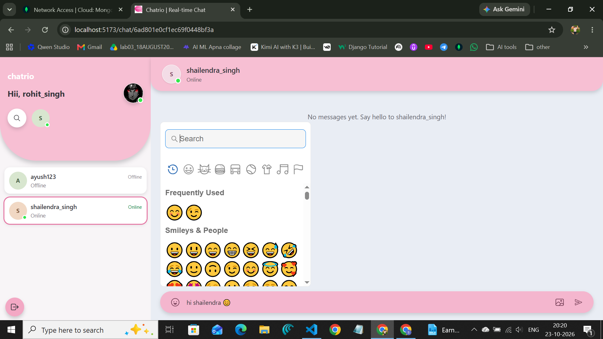

<div align="center">

# Chatrio

### A friendly, real-time chat app for private conversations

Create an account, find people who are online, and chat with text, images, emojis, and replies.

[Features](#features) · [Screenshots](#screenshots) · [Run locally](#run-locally) · [Deploy](#deploy-to-render)

</div>

> **Live demo:** Chatrio has not been deployed yet, so there is no working public app URL to share today. Use the Render button below to create a temporary live deployment. Render will provide the actual URL after the service is deployed and connected to MongoDB.

[](https://render.com/deploy?repo=https://github.com/shailendraapi06/Chatrio-)

## About

Chatrio is a full-stack private messaging application. The React client talks to an Express API, stores account and chat data in MongoDB, and uses Socket.IO for live presence and message delivery.

## Features

- **Accounts and authentication:** Sign up, log in, log out, and restore a session with an HTTP-only authentication cookie.
- **Private one-to-one chats:** Start conversations with other registered users.
- **Real-time messaging:** Send and receive messages instantly with Socket.IO.
- **Online presence:** See which contacts are currently connected.
- **Text and image messages:** Send text, or PNG, JPEG, and WebP images up to 1 MB.
- **Message replies:** Reply to a message and see a preview of the original.
- **Emoji picker:** Add emojis to messages.
- **Link detection:** HTTP(S) links in messages are displayed as clickable links.
- **Image viewer:** Open, zoom, and download image messages.
- **Expiring messages:** Messages are hidden after 12 hours and MongoDB removes expired documents in the background.
- **Delete for me:** Hide an individual message from your own history without removing it for the other participant.
- **Delete chat for me:** Hide the conversation's existing history from your account; future messages can make the chat visible again.
- **Profile management:** Update your username, email, and profile photo.
- **Responsive layout:** Chat on desktop or mobile.

## Screenshots

### Emoji picker and chat composer



### Conversation and message history


### Sending and receiving messages


### Image message


## Tech stack

| Area | Technologies |
| --- | --- |
| Frontend | React 19, Vite, React Router, Redux Toolkit, Tailwind CSS |
| Backend | Node.js (22.12+), Express 5 |
| Database | MongoDB with Mongoose |
| Real time | Socket.IO |
| Authentication | JWT in an HTTP-only cookie, bcrypt password hashing |
| Deployment | Render Blueprint; one service serves the frontend, API, and Socket.IO |

## Project structure

```text
.
├── backend/
│   ├── config/          # MongoDB and JWT configuration
│   ├── controllers/     # Authentication, user, and message handlers
│   ├── middlewares/     # Authentication middleware
│   ├── models/          # Mongoose schemas
│   ├── routes/          # API routes
│   ├── scripts/         # Database maintenance scripts
│   ├── socket/          # Authenticated Socket.IO presence
│   └── index.js         # Express and Socket.IO server
├── frontend/
│   ├── src/
│   │   ├── components/  # Chat, message area, and sidebar
│   │   ├── pages/       # Login, signup, and profile
│   │   ├── redux/       # API client and account state
│   │   └── realtime/    # Socket.IO client
│   └── vite.config.js
├── render.yaml          # Render Blueprint
└── DEPLOYMENT.md        # Render deployment and operations guide
```

## Requirements

- Node.js **22.12 or later, below 25**
- npm
- A MongoDB database (local MongoDB or MongoDB Atlas)

## Run locally

### 1. Configure the backend

From the repository root, create the backend environment file:

```powershell
Copy-Item backend\.env.example backend\.env
```

Edit `backend/.env` and set at least:

```dotenv
MONGO_URL=mongodb://127.0.0.1:27017/chatrio
JWT_SECRET=replace-with-a-long-random-secret
PORT=8000
FRONTEND_URL=http://localhost:5173
```

Generate a strong secret locally if needed:

```sh
node -e "console.log(require('crypto').randomBytes(32).toString('hex'))"
```

Keep `backend/.env` private. Do not commit database credentials or JWT secrets.

Install backend dependencies and start the API:

```sh
npm --prefix backend install
npm --prefix backend run dev
```

The backend runs at `http://localhost:8000`.

### 2. Start the frontend

Open another terminal in the repository root:

```sh
npm --prefix frontend install
npm --prefix frontend run dev
```

Open the Vite URL shown in the terminal (normally `http://localhost:5173`).
During local development, the frontend uses `http://localhost:8000` for the API
and Socket.IO server.

## Production build

Build the React application:

```sh
npm --prefix frontend run build
```

For a local single-origin production run, set `NODE_ENV=production`, provide
`MONGO_URL` and `JWT_SECRET` to the backend, then start it:

```sh
npm --prefix backend start
```

The production Express server serves the built `frontend/dist` directory,
including the client-side routes.

## Deploy to Render

This repository includes [`render.yaml`](./render.yaml). It configures one
Render web service that builds the React frontend and serves it from Express
alongside the API and Socket.IO. This same-origin setup avoids separate
frontend/backend cookie configuration.

1. Push the repository to GitHub.
2. Create a MongoDB Atlas database and database user.
3. In Atlas Network Access, allow the Render service to connect.
4. In Render, create a **New Blueprint** and select this repository.
5. Set the Render service's `MONGO_URL` environment variable to the Atlas
   connection string. Render generates `JWT_SECRET` from the Blueprint.
6. Wait for the `/healthz` check to pass. Open the service URL shown by Render;
   that is the live demo URL to share.

See [`DEPLOYMENT.md`](./DEPLOYMENT.md) for more deployment details and
operational notes.

## Environment variables

| Variable | Required | Description |
| --- | --- | --- |
| `MONGO_URL` | Yes | MongoDB connection string |
| `JWT_SECRET` | Yes | Secret used to sign and verify login tokens |
| `PORT` | No | HTTP port; defaults to `8000` |
| `FRONTEND_URL` | No | Allowed frontend origin when using a separate host; local default is `http://localhost:5173` |
| `NODE_ENV` | No | Set to `production` on deployment |
| `VITE_SERVER_URL` | No | Frontend API/socket origin for a separate backend; leave unset for Render's single-service setup |

Chat and profile images are currently stored as base64 data in MongoDB, so
Cloudinary credentials are not required for this implementation. Each image is
limited to 1 MB.

## API overview

All endpoints except signup and login require the authentication cookie.

| Method | Endpoint | Description |
| --- | --- | --- |
| `POST` | `/api/auth/signup` | Create an account |
| `POST` | `/api/auth/login` | Log in |
| `POST` | `/api/auth/logout` | Log out |
| `GET` | `/api/users/current` | Get the current account |
| `GET` | `/api/users/contacts` | List people and recent conversations |
| `PUT` | `/api/users/profile` | Update profile details |
| `POST` | `/api/v1/message/send/:userId` | Send a text or image message |
| `GET` | `/api/v1/message/get/:userId` | Get chat history |
| `DELETE` | `/api/v1/message/delete/:userId` | Delete chat history for the current user |
| `DELETE` | `/api/v1/message/:userId/message/:messageId` | Delete one message for the current user |
| `GET` | `/healthz` | Check server and MongoDB readiness |

## Notes and limitations

- Message visibility expires after 12 hours. MongoDB TTL deletion is handled in
  the background and may occur after the exact expiration time.
- “Delete for me” hides a message only from the current user's history; it does
  not remove the other participant's copy.
- Since images are stored in MongoDB, plan database capacity and backups as
  usage grows.
- Render's free web services may sleep while idle. Use an always-on plan if
  uninterrupted realtime availability is required.

## License

This project is licensed under the [MIT License](./LICENSE).
